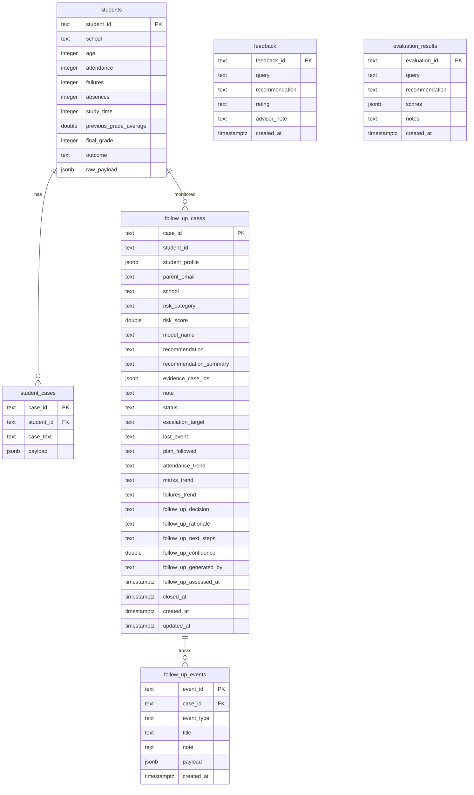

# Database Architecture — AI-Powered Student Success Assistant

> **Version:** 0.1.0  
> **Primary Database:** PostgreSQL 16 (Aiven)  
> **Vector Store:** Qdrant (managed cloud)  
> **Migrations:** Alembic / SQLAlchemy 2.0 (async)

---

## Table of Contents

1. [Entity-Relationship Diagram](#1-entity-relationship-diagram)
2. [Table Reference](#2-table-reference)
3. [Indexes](#3-indexes)
4. [Data Storage Strategy](#4-data-storage-strategy)
5. [Qdrant Collection](#5-qdrant-collection)
6. [Architecture Decisions](#6-architecture-decisions)
7. [Queries](#7-queries)

---

## 1. Entity-Relationship Diagram



### Relationship Descriptions

| Relationship | Source | Target | Cardinality | Description |
|---|---|---|---|---|
| `has` | `students` | `student_cases` | One-to-Many | A student may have multiple case narratives logged by advisors. Cascading delete removes all cases when a student is purged. |
| `monitored` | `students` | `follow_up_cases` | One-to-Many | A student may have zero or more follow-up cases created over time (e.g., one per school term). |
| `tracks` | `follow_up_cases` | `follow_up_events` | One-to-Many | Each follow-up case has a timeline of events (escalation, communication, review, closure). Cascading delete removes events when the parent case is deleted. |

> `feedback` and `evaluation_results` are standalone tables — they record user feedback and LLM-as-judge evaluations respectively, and are not directly FK-linked to students or cases.

---

## 2. Table Reference

### `students`

Stores each student's demographic, academic, and behavioural record ingested from the school's MIS. Used as the source of truth for prediction features.

| Column | Type | Constraints | Description |
|---|---|---|---|
| `student_id` | `TEXT` | `PRIMARY KEY` | Unique student identifier (from MIS). |
| `school` | `TEXT` | `NOT NULL` | School name or code the student belongs to. |
| `age` | `INTEGER` | `NOT NULL` | Student age at time of data collection. |
| `attendance` | `INTEGER` | `NOT NULL` | Attendance percentage (0–100). |
| `failures` | `INTEGER` | `NOT NULL` | Number of past class failures. |
| `absences` | `INTEGER` | `NOT NULL` | Total number of school absences. |
| `study_time` | `INTEGER` | `NOT NULL` | Weekly study hours (categorical 1–4). |
| `previous_grade_average` | `DOUBLE PRECISION` | `NOT NULL` | Average grade from prior academic period. |
| `final_grade` | `INTEGER` | `NOT NULL` | Final grade (0–20). |
| `outcome` | `TEXT` | `NOT NULL` | Binary outcome: `"Pass"` or `"Fail"`. |
| `raw_payload` | `JSONB` | `NOT NULL DEFAULT '{}'` | Original ingestion payload for auditability. |

### `student_cases`

Stores unstructured/narrative case text written by advisors about a student. Used for similarity retrieval via Qdrant.

| Column | Type | Constraints | Description |
|---|---|---|---|
| `case_id` | `TEXT` | `PRIMARY KEY` | UUID v4 identifying the case narrative. |
| `student_id` | `TEXT` | `NOT NULL` · `FK → students(student_id) ON DELETE CASCADE` | The student this case belongs to. |
| `case_text` | `TEXT` | `NOT NULL` | Free-form narrative written by the advisor. |
| `payload` | `JSONB` | `NOT NULL DEFAULT '{}'` | Optional structured metadata attached to the case. |

### `feedback`

Records user (advisor) feedback on recommendations for offline evaluation and continuous improvement.

| Column | Type | Constraints | Description |
|---|---|---|---|
| `feedback_id` | `TEXT` | `PRIMARY KEY` | UUID v4. |
| `query` | `TEXT` | `NOT NULL` | Original query that triggered the recommendation. |
| `recommendation` | `TEXT` | `NOT NULL` | The recommendation text that was shown. |
| `rating` | `TEXT` | `NOT NULL` | User rating: e.g. `"helpful"`, `"not_helpful"`. |
| `advisor_note` | `TEXT` | `nullable` | Optional free-text note from the advisor. |
| `created_at` | `TIMESTAMPTZ` | `NOT NULL DEFAULT now()` | When the feedback was submitted. |

### `evaluation_results`

Stores LLM-as-judge evaluation scores for automated quality assessment of recommendations.

| Column | Type | Constraints | Description |
|---|---|---|---|
| `evaluation_id` | `TEXT` | `PRIMARY KEY` | UUID v4. |
| `query` | `TEXT` | `NOT NULL` | The query used during evaluation. |
| `recommendation` | `TEXT` | `NOT NULL` | The recommendation that was evaluated. |
| `scores` | `JSONB` | `NOT NULL` | LLM-judge scores (e.g., `{"relevance": 0.95, "factuality": 0.88}`). |
| `notes` | `TEXT` | `NOT NULL` | Judge rationale or commentary. |
| `created_at` | `TIMESTAMPTZ` | `NOT NULL DEFAULT now()` | When the evaluation was recorded. |

### `follow_up_cases`

Tracks ongoing intervention cases that require periodic reassessment by the Follow-Up Agent.

| Column | Type | Constraints | Description |
|---|---|---|---|
| `case_id` | `TEXT` | `PRIMARY KEY` | UUID v4 identifying the follow-up case. |
| `student_id` | `TEXT` | `NOT NULL` | The student under monitoring. |
| `student_profile` | `JSONB` | `NOT NULL` | Snapshot of student attributes at case creation. |
| `parent_email` | `TEXT` | `nullable` | Parent/guardian contact for notifications. |
| `school` | `TEXT` | `NOT NULL` | School the student belongs to. |
| `risk_category` | `TEXT` | `NOT NULL` | e.g. `"High"`, `"Medium"`, `"Low"`. |
| `risk_score` | `DOUBLE PRECISION` | `NOT NULL` | Numerical risk score from the prediction model (0–1). |
| `model_name` | `TEXT` | `NOT NULL` | The model version that produced the risk score. |
| `recommendation` | `TEXT` | `NOT NULL` | Full text of the recommended intervention. |
| `recommendation_summary` | `TEXT` | `NOT NULL` | Condensed summary for quick reference. |
| `evidence_case_ids` | `JSONB` | `NOT NULL DEFAULT '[]'` | Array of `student_cases.case_id` used as evidence. |
| `note` | `TEXT` | `NOT NULL DEFAULT ''` | Advisor note added at creation. |
| `status` | `TEXT` | `NOT NULL` | Current status: `"active"`, `"closed"`, `"escalated"`. |
| `escalation_target` | `TEXT` | `NOT NULL` | Who to escalate to (e.g. `"head_of_year"`, `"counsellor"`). |
| `last_event` | `TEXT` | `NOT NULL` | Short label of the most recent event (e.g. `"escalated"`, `"reviewed"`). |
| `plan_followed` | `TEXT` | `NOT NULL DEFAULT 'Unknown'` | Whether the intervention plan was followed (`"Yes"`, `"No"`, `"Unknown"`). |
| `attendance_trend` | `TEXT` | `NOT NULL DEFAULT 'No new evidence'` | Trend summary since last assessment. |
| `marks_trend` | `TEXT` | `NOT NULL DEFAULT 'No new evidence'` | Academic performance trend. |
| `failures_trend` | `TEXT` | `NOT NULL DEFAULT 'Unknown'` | Failures trend since last assessment. |
| `follow_up_decision` | `TEXT` | `nullable` | Decision made by the Follow-Up Agent: e.g. `"close"`, `"continue"`, `"escalate"`. |
| `follow_up_rationale` | `TEXT` | `nullable` | Agent's reasoning behind the decision. |
| `follow_up_next_steps` | `TEXT` | `nullable` | Recommended next actions. |
| `follow_up_confidence` | `DOUBLE PRECISION` | `nullable` | Confidence score for the decision (0–1). |
| `follow_up_generated_by` | `TEXT` | `nullable` | Agent or model that generated the assessment. |
| `follow_up_assessed_at` | `TIMESTAMPTZ` | `nullable` | When the follow-up assessment was performed. |
| `closed_at` | `TIMESTAMPTZ` | `nullable` | When the case was closed. |
| `created_at` | `TIMESTAMPTZ` | `NOT NULL DEFAULT now()` | When the case was created. |
| `updated_at` | `TIMESTAMPTZ` | `NOT NULL DEFAULT now()` | When the case was last updated. |

### `follow_up_events`

Audit trail of all actions and state transitions within a follow-up case.

| Column | Type | Constraints | Description |
|---|---|---|---|
| `event_id` | `TEXT` | `PRIMARY KEY` | UUID v4 identifying the event. |
| `case_id` | `TEXT` | `NOT NULL` · `FK → follow_up_cases(case_id) ON DELETE CASCADE` | The follow-up case this event belongs to. |
| `event_type` | `TEXT` | `NOT NULL` | Event type: `"created"`, `"escalated"`, `"reviewed"`, `"contacted"`, `"closed"`, etc. |
| `title` | `TEXT` | `NOT NULL` | Human-readable event title. |
| `note` | `TEXT` | `nullable` | Optional detail or comment for the event. |
| `payload` | `JSONB` | `NOT NULL DEFAULT '{}'` | Machine-readable event metadata. |
| `created_at` | `TIMESTAMPTZ` | `NOT NULL DEFAULT now()` | When the event occurred. |

---

## 3. Indexes

| Index Name | Table | Column(s) | Type | Purpose |
|---|---|---|---|---|
| `idx_follow_up_cases_status` | `follow_up_cases` | `status` | B-tree | Fast filtering of active / closed / escalated cases for the scheduler. |
| `idx_follow_up_events_case_id` | `follow_up_events` | `case_id` | B-tree | Efficient lookup of all events for a given follow-up case. |

---

## 4. Data Storage Strategy

| Store | What It Holds | Why |
|---|---|---|
| **PostgreSQL** | Structured student data (`students`), case narratives (`student_cases`), feedback (`feedback`), evaluations (`evaluation_results`), follow-up cases and events (`follow_up_cases`, `follow_up_events`). | ACID compliance, JSONB for flexible schemas, relational integrity across student–case–follow-up relationships. Managed via Aiven. |
| **Qdrant** | Vector embeddings of `student_cases.case_text` (384-dimensional BGE embeddings), with payload metadata. | Managed cloud vector store for cosine-similarity retrieval with payload filtering and horizontal scaling. |

**Key distinction:** Full case narrative text lives in PostgreSQL (`student_cases.case_text`). Qdrant stores only the vector embedding and a subset of the payload for efficient similarity search.

**Qdrant payload fields:**
| Field | Source |
|---|---|
| `case_id` | `student_cases.case_id` |
| `student_id` | `student_cases.student_id` |
| `school` | `students.school` (denormalized) |
| `failures` | `students.failures` (denormalized) |
| `absences` | `students.absences` (denormalized) |
| `final_grade` | `students.final_grade` (denormalized) |

---

## 5. Qdrant Collection

| Property | Value |
|---|---|
| **Collection name** | `student_cases` |
| **Vector size** | 384 (BGE-base-en-v1.5 embeddings) |
| **Distance metric** | Cosine |
| **Payload** | `case_id`, `student_id`, `school`, `failures`, `absences`, `final_grade` |
| **Indexing** | HNSW (default) |

---

## 6. Architecture Decisions

| Decision | Rationale |
|---|---|
| **PostgreSQL over MongoDB** | Relational integrity is required for student–case–feedback–follow-up relationships. Foreign keys and cascading deletes simplify data lifecycle management. Team has existing SQL expertise. |
| **PostgreSQL over Neo4j** | No complex graph traversal needs across the data model. Simple foreign-key joins between a small set of tables are sufficient. |
| **Qdrant over pgvector** | Qdrant offers a managed cloud service with built-in horizontal scaling, payload filtering, and cosine similarity out of the box. Separating the vector-store workload from the OLTP PostgreSQL database avoids resource contention. |
| **JSONB for flexible columns** | `raw_payload`, `payload`, `scores`, and `evidence_case_ids` use JSONB to allow schemaless extension without migrations. This is critical for accommodating varied MIS ingestion formats and evolving evaluation criteria. |
| **TIMESTAMPTZ over TIMESTAMP** | All timestamp columns use `TIMESTAMPTZ` (with time zone) to avoid ambiguity when the system operates across multiple time zones or the database server's timezone changes. |

---

## 7. Queries

### 7.1 — Active high-risk follow-up cases with latest event

```sql
SELECT
  fc.case_id,
  fc.student_id,
  fc.risk_score,
  fc.risk_category,
  fc.status,
  fc.last_event,
  fe.title  AS last_event_title,
  fe.created_at AS last_event_at
FROM follow_up_cases fc
LEFT JOIN LATERAL (
  SELECT title, created_at
  FROM follow_up_events
  WHERE case_id = fc.case_id
  ORDER BY created_at DESC
  LIMIT 1
) fe ON TRUE
WHERE fc.status = 'active'
  AND fc.risk_category = 'High'
ORDER BY fc.risk_score DESC;
```

### 7.2 — Student with most open follow-up cases

```sql
SELECT
  s.student_id,
  s.school,
  s.outcome,
  COUNT(fc.case_id) AS open_cases
FROM students s
JOIN follow_up_cases fc ON fc.student_id = s.student_id
WHERE fc.status = 'active'
GROUP BY s.student_id, s.school, s.outcome
ORDER BY open_cases DESC
LIMIT 10;
```

### 7.3 — Similar cases by Qdrant vector search (pseudo-code)

```python
# Using the Qdrant client
client.search(
    collection_name="student_cases",
    query_vector=embedding,          # 384-d vector
    limit=5,
    query_filter=models.Filter(
        must=[
            models.FieldCondition(
                key="school",
                match=models.MatchValue(value="Springfield High"),
            ),
        ]
    ),
)
```

### 7.4 — Follow-up cases created in the last 30 days with no assessment

```sql
SELECT
  case_id,
  student_id,
  risk_category,
  created_at
FROM follow_up_cases
WHERE created_at >= now() - INTERVAL '30 days'
  AND follow_up_assessed_at IS NULL
  AND status = 'active'
ORDER BY risk_score DESC;
```

### 7.5 — Feedback summary by rating

```sql
SELECT
  rating,
  COUNT(*)            AS count,
  MIN(created_at)     AS first_received,
  MAX(created_at)     AS last_received
FROM feedback
GROUP BY rating
ORDER BY count DESC;
```

### 7.6 — Latest evaluation scores trend

```sql
SELECT
  DATE_TRUNC('day', created_at) AS eval_date,
  AVG((scores->>'relevance')::NUMERIC)     AS avg_relevance,
  AVG((scores->>'factuality')::NUMERIC)    AS avg_factuality
FROM evaluation_results
WHERE created_at >= now() - INTERVAL '7 days'
GROUP BY DATE_TRUNC('day', created_at)
ORDER BY eval_date;
```
