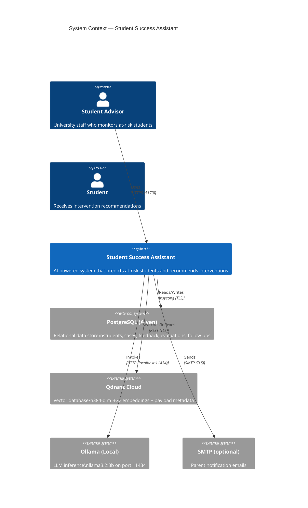
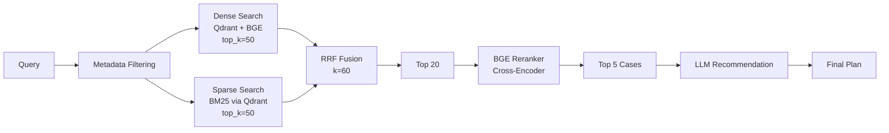
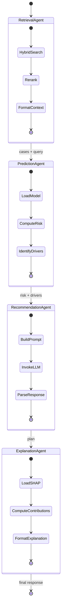
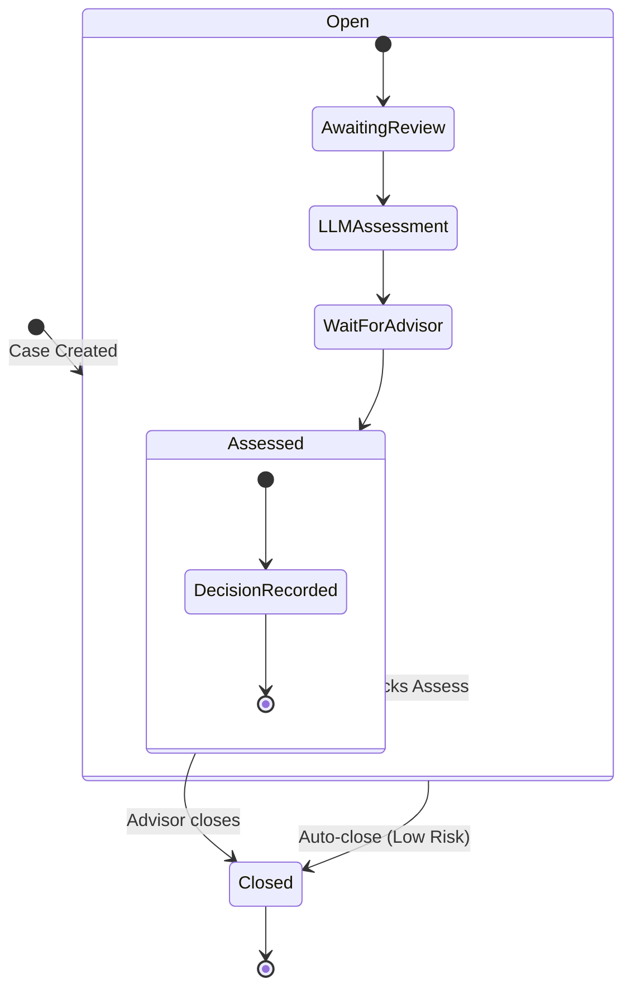
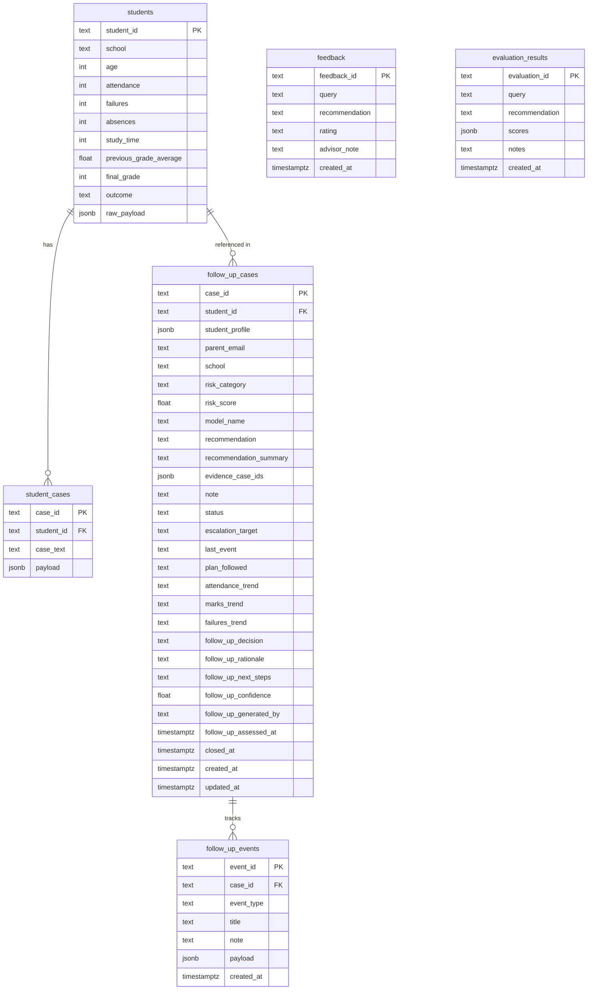
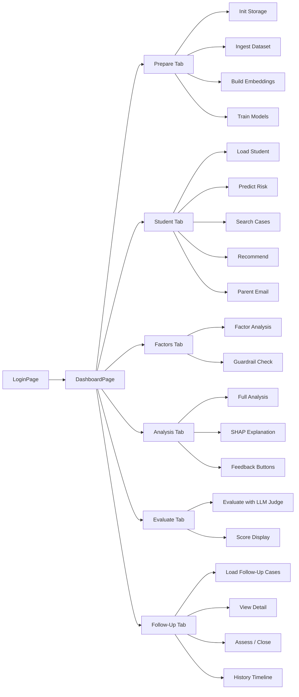
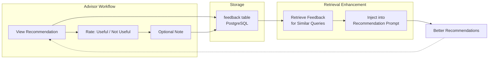
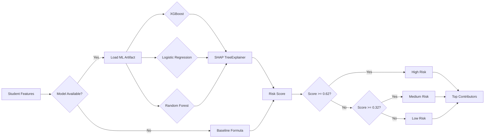

# System Diagrams — AI-Powered Student Success Assistant

> Mermaid diagrams for architecture, data flow, and process visualization.
> Render with any Mermaid-compatible viewer (VS Code, GitHub, mermaid.live).

---

## 1. High-Level System Architecture



---

## 2. Hexagonal Architecture (Ports & Adapters)

```mermaid
block-beta
    columns 3

    block:adapters_out("Outbound Adapters"):1
        l1("PostgresAdapter")
        l2("QdrantAdapter")
        l3("OllamaAdapter")
        l4("SmtpAdapter")
    end

    block:ports("Ports"):1
        m1("StudentRepository")
        m2("CaseRepository")
        m3("FeedbackRepository")
        m4("FollowUpRepository")
        m5("LLMClient")
        m6("EmbeddingService")
    end

    block:app("Application"):1
        r1("PredictionService")
        r2("RetrievalService")
        r3("RecommendationService")
        r4("EvaluationService")
        r5("FollowUpService")
        r6("InsightService")
    end

    block:domain("Domain"):1
        d1("StudentProfile")
        d2("RiskCategory")
        d3("JudgeScores")
        d4("FollowUpCase")
        d5("FeedbackEntry")
    end

    block:api("API Layer"):1
        a1("FastAPI Routes")
        a2("Pydantic Schemas")
        a3("Auth Middleware")
    end

    adapters_out --> ports
    ports --> app
    app --> domain
    app --> api
```



---

## 3. RAG Pipeline



---

## 4. LangGraph Agent Workflow



---

## 5. Fallback Architecture

```mermaid
flowchart TD
    subgraph LLM_Fallback["LLM Chain"]
        A[LangGraph Agent] -->|fails| B[Direct LLM Call]
        B -->|fails| C[Drafted Intervention Plan]
    end

    subgraph Eval_Fallback["Evaluation Chain"]
        D[LLM-as-Judge] -->|fails or invalid JSON| E[Rubric Baseline]
    end

    subgraph FollowUp_Fallback["Follow-Up Chain"]
        F[LLM Assessment] -->|fails| G[Signal-Counting Rubric]
    end

    subgraph Retrieval_Fallback["Retrieval Chain"]
        H[Hybrid Search] -->|fails| I[Repository Search]
        I -->|fails| J[Synthetic Data]
    end

    subgraph Prediction_Fallback["Prediction Chain"]
        K[ML Artifact] -->|missing| L[Baseline Advisor Score]
    end

    subgraph Embed_Fallback["Embedding Chain"]
        M[Sentence-Transformers] -->|fails| N[Hash-Based Fallback]
    end
```



---

## 6. Follow-Up Lifecycle



---

## 7. ER Diagram



---

## 8. Evaluation (LLM-as-Judge) Flow

```mermaid
flowchart LR
    A[Query + Recommendation + Evidence] --> B[Build Judge Prompt]
    B --> C[Invoke LLM]
    C --> D{JSON Valid?}
    D -->|Yes| E[Parse JudgeScores]
    D -->|No| F[Regex: quote unquoted keys]
    F --> G{Valid now?}
    G -->|Yes| E
    G -->|No| H[Rubric Baseline]

    E --> I[Compute Overall<br/>(relevance + groundedness + consistency + usefulness) / 4]
    H --> I
    I --> J[Store in evaluation_results]
    J --> K[Return EvaluationResponse]
```

---

## 9. Frontend Screen Flow



---

## 10. Feedback Loop



---

## 11. Risk Prediction Pipeline


